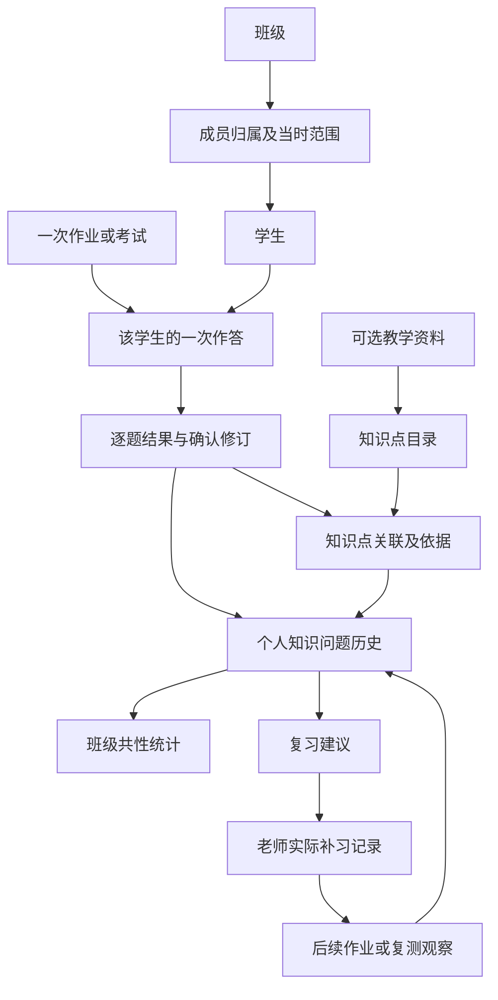

# 晋学智辅：学习档案主线的 MVP 与数据关系讨论稿

日期：2026-11-08。代码核对基点：f2bd420，现有本地试用版v0.26。

**已确认方向来自用户本轮指令；下文具体录入字段、统计规则和开发顺序是供讨论的建议，尚未批准实施。** 本轮只修改产品文档，不改应用代码、数据结构、真实档案或部署，不启动新一轮功能开发。

## 1. 这次收敛的目标

老师负责作业、试卷、教案、批改与教学。系统把老师已确认的学习事实，组织成每个学生长期可追溯的数学学习档案，帮助老师看清“过去在哪些知识点出现问题，后来怎样补过，现在表现如何”。

新的主线：

**录入／导入老师批改结果 → 关联知识点 → 保留个人历史 → 发现重复问题与班级共性 → 提出有依据的复习建议 → 记录老师实际补习 → 关联后续作业／复测 → 更新观察。**

OCR是可选输入辅助，AI判题是可选核对；自动出题、六步教案、三级变式和学习方法库后置。没有照片、教案、独立标准答案、可用模型或第二次真实考试，也能继续开发并用标明来源的测试数据验证记录与汇总逻辑；缺少的真实学习事实保持未知，不能伪造来完成验收。

范围仍为山西初中数学、现有小班的本地老师使用场景；完整初中知识是内容目标，不能宣称目录已经教研审定。此次不扩其他三科、家长端、收费、多机构权限或心理档案。

## 2. 调整后的 MVP 建议

|核心能力|第一版应完成的最小行为|已有基础与主要差距|
|---|---|---|
|每生长期档案|按学生查看历次作业、已确认问题、关联知识、老师备注、补习及复测；原记录与修订都可追溯|已有个人档案、确认历史、证据窗口和报告；需将其作为主要入口，补齐非练习形式的反馈|
|教师结果录入与批量导入|手动录入可用；批量导入先预览学生、作业、题号、结果和知识关联，确认后才入档；失败和重复不静默处理|现有逐题编辑、单卷questions JSON导入和整卷确认可复用；普通老师用的表格批量入口、多学生分组及覆盖范围仍缺|
|知识点关联|用稳定知识点识别同一内容；允许先待关联，保留来源和修订；教案是可选参考|现有文字标签与资料条目引用；需要不依赖教案的知识目录，目录和资料分开|
|反复问题识别|区分单次错误、同卷多错、不同作答次的重复问题；每条线索能展开原题证据|已有保守去重与跨份线索；需明确作答次、实际日期、重做／重传和知识身份|
|班级学情统计|明确班级与观察范围，统计涉及学生及证据，未录／待核／缺材料单列；不能以题号代替知识点|已有本批次知识共性；需要固定班级成员及跨批次范围，不能把批次名称当班级|
|复习反馈与效果跟踪|根据历史给老师复习建议；老师可登记复讲、订正或自备练习；后续结果回到原知识问题|已有练习版本、复测、跟进待办；目前复测挂在已批准练习上，需支持老师自备材料和一般补习记录|

### 当前不作为交付前提

- 全自动OCR、自动判分或每题转写完整解题过程。
- 自动生成题目、强制三档练习、学习方法选择器、完整题库和完整教案库。
- 自动发放作业、自动认定掌握、预测中考分数、复杂知识图谱或自动复习日历。
- 会员、支付、外部中转合作、学生／家长独立端及跨机构平台。

已有相关能力和试卷分析原样保留；后置不等于删除，不把它们当作新的主线验收关卡。

## 3. 最少输入：减少重录，不制造资料要求

建议以“某个学生的某次作业”为记录单位。手动录入和批量导入最终进入相同待审流程，而不是各建一套档案。

|信息|建议规则|
|---|---|
|学生、本次作业标识、题号／原题定位、老师判定|最少必要信息；不明归属留待核，不凭姓名相似自动合并|
|知识点|最好有；未确定可暂存“待关联”，不能据此生成明确知识诊断|
|实际作业日期、作答方式|鼓励记录；未知明确显示未知，录入时间不冒充考试日期|
|本次登记覆盖范围|至少区分“完整结果”“仅问题摘录”“未知”；缺少原卷总题量时不能称整卷收齐|
|老师反馈、原题照片／页码、学生过程、参考答案|按已有材料选填；不强制为录一条错题重写整份卷、逐字抄原答或补一份标准答案|

只有题号和原卷页码时，应保存真实定位；没有题干就标记正文未录，不能用AI补造原题。错因不足时留“原因待核”，不强制填写“粗心”等解释。

批量入口的建议优先项是老师从表格复制粘贴；CSV文件可作为备选，原生Excel多工作表解析不默认加入。本轮不把现有单卷JSON导入描述为已支持多学生Excel导入。具体先实现哪种入口，留在实施前的小范围讨论。

建议每生逐次确认**本次实际登记的条目与覆盖范围**，批量导入不等于自动批准。只摘录错题时不能显示“整卷全部核完”。这需要调整当前整卷审核的表达和数据依据，本轮尚未改变现有软件确认规则。

## 4. 数据关系：先统一业务概念，不执行建表

图表示业务关联，不指定新数据库技术；班级统计还须按班级成员和观察范围筛选。教学资料只提供参考，不能反过来证明学生掌握情况。

|对象|最少需要保存什么|重要关系与边界|
|---|---|---|
|学生|稳定本地标识、称呼；身份关系本地保存|一个学生可积累多次作答，不能因换卷或改名重建成另一个人|
|班级与成员归属|班级标识、成员、归属依据／适用时段；不清楚的历史留待核|班级拥有多次作业；调整现在班级时不能静默重算旧卷归属|
|作业／考试|独立活动标识、标题、实际日期或未知、对应班级范围、可选材料|与长期班级不同；同一次活动下每个学生的记录分别保存|
|学生作答次|学生、作业、首次作答／重做／复测／条件未知、来源、登记覆盖范围|同卷重传不是新作答；同题重新做过才可能是另一作答次，“另一次作答”不等于“无提示独立完成”|
|逐题结果与修订|题号／定位、老师结果、可选原答／批注、确认状态及时间、输入来源、历史版本|一条事实可修订，但原版本保留；AI候选与教师结论分开，不把改判计作新错误|
|知识点目录与关联|稳定知识点标识、名称、层级、关联依据／待核状态、必要历史|知识点不是题号、题型或某份教案；一道题可能涉及多个知识，不能自动把综合题做错算为所有关联知识都不会|
|复习建议|对应学生／知识点、引用哪些事实、建议复习什么及原因、待教师取舍状态|建议是分析，不是已发生补习；先用可解释规则组织，AI只能辅助整理，不新增训练专用模型|
|实际补习与反馈|老师实际做了什么、日期或未知、关联学生／问题、简短反馈、可选材料定位|可以是课堂复讲、课后订正、自备练习，不依赖系统先生成一套练习|
|后续作业／复测观察|对应问题／补习、实际任务与原答定位、结果、完成条件、教师确认|后续原卷结果与复测结果可互相引用但只统计一次；一次正确保留为改善证据，不删除旧错题|

“一道题可关联多个知识”在本稿中是建议模型，不代表首版要做复杂知识图谱。最小方案可先由老师选一个主要问题知识点，其他只作相关知识；未核实的相关知识不直接产生薄弱结论。

## 5. 统计与建议的最低可信规则（建议，待讨论）

1. **事实、分析、行动分开。** 老师确认“本题错”是事实；“跨次出现分式限制问题”是分析；“明天复讲分母限制”是建议；“老师已复讲”是实际行动。不得互相代填。
2. **不同作答次才形成跨次线索。** 同卷两题错可显示“本次两处问题”；至少有两次互不重复、已确认且知识关联可靠的作答，才显示跨次重复线索。这里两次是“跨次”成立的最低证据，不是诊断长期薄弱的阈值；日期未知时只能称不同作答记录，不能称跨日遗忘。
3. **自动识别不等于自动定性。** 系统可以自动归组、计数并列出证据，不要求老师每次手工找重复；但不凭计数断言概念不懂或稳定掌握。错误与部分正确分别显示。
4. **只录错题时不算整体错误率。** 可说“本观察范围有3名学生登记了该知识问题”，不能说“其余7人已掌握”。班级名册人数、已收记录人数、覆盖该知识的有效确认人数、问题人数分别显示；信息不足就只报人数和覆盖情况。
5. **统计范围必须可见。** 本次作业共性与班级一段历史的重复问题分开选择；按当时班级归属、作业及可用实际日期筛选，不把所有批次混成无边界总榜。日期未知单列，不自动归到最近一周。
6. **最新表现和历史并列。** 例如两次错误后一次独立正确，显示“历史两次问题；最近一次独立正确，继续观察”，不删除问题历史，也不将其永远当作当前持续错误。
7. **缺知识、缺材料、待确认单列。** 未录入与正确不同；没有明确错因不妨碍记录本次错误，但会限制建议深度。
8. **建议必须能解释。** 建议旁能看到哪些作业、哪些题及老师反馈支持它；老师可选用或调整。建议数量、排序和观察窗口不在本稿里假定已定，不增加自动发布或复杂评分算法。

## 6. 如何利用现有项目，不重做

本轮只读核对以下代码；“已有”是源码行为，不是本轮重跑测试或真实教学验收。

|现有能力／代码|继续复用|需要补齐的部分|
|---|---|---|
|[Store](../../app/store.py)、逐题编辑与单卷JSON导入|学生标识、逐生作业、待审保存、教师确认、追加历史、原题证据|更轻的教师结果表格入口、输入覆盖范围、来源定位；不可强迫重抄每题题干和标准答案|
|[student_archive.py](../../app/student_archive.py)、[profile_report.py](../../app/profile_report.py)|个人历史、当前确认、证据追溯及报告|让档案／知识问题成为主入口；把复习建议和实际补习接到同一历史|
|[learning_analysis.py](../../app/learning_analysis.py)|去重、同卷多错／跨份线索、只读汇总|从“资料条目或文字标签”补为独立知识身份；明确作答次和未知日期，保留旧归组证据|
|[teaching.py](../../app/teaching.py)|资料版本、出处及已审核资料引用|资料引用不再承担全部知识身份；没有教案时也能记录和关联知识；现有单个teaching_ref不能冒称多知识关联已实现|
|[class_analysis.py](../../app/class_analysis.py)、Store.summary|同知识问题按学生去重、原题证据追溯|当前仅按batch_id，缺长期班级成员和跨批次观察范围；批次不直接改名成班级|
|[learning_journey.py](../../app/learning_journey.py)、[knowledge_followup.py](../../app/knowledge_followup.py)、[practice_queue.py](../../app/practice_queue.py)|原问题→练习版本→真实复测的证据链，旧版与当前版区分|现有复测必须挂在已批准练习，练习要求三档及答案；一般教师补习、老师自备任务和后续普通作业不能继续被这条生成流程卡住|
|[assignment_dates.py](../../app/assignment_dates.py)|可选实际作业日期及历史依据|继续区分实际学习日期与登记时间；新增反馈日期仍需设计，不猜旧数据日期|
|附件、备份恢复、授权预览|原件、历史及本地资料保护|维持边界，不因方向调整重新上传完整档案或覆盖既有资料|

候选实施方式只有一条适合当前约束：**沿用本地应用与历史记录，逐项补齐领域关系和老师输入。** 另建一套档案软件或继续把OCR作为主入口都会增加重复工作，不建议。此为产品调整建议，不是已批准的技术迁移方案；旧知识引用、旧批次和旧复测一律保留，映射不明时待核，不批量猜测迁移。

## 7. 调整后的路线：4个业务交付点，尚未排编码任务

|顺序|交付目标|达到什么程度才算完成|
|---|---|---|
|1 低负担输入与档案|老师手动录入／批量导入批改结果，按学生和作业追溯；不依赖照片识别|无OCR、无标准答案也可保存合法记录；重复不增次、改判保留历史、摘录与完整结果分清|
|2 知识关联与重复问题|独立知识目录连接个人历次确认事实|无教案可关联；同卷多错、重传、改判、真实重做分清；同名不同义不误并，改名不丢旧证据|
|3 班级学情与复习建议|在明确班级和观察范围内汇总共性，并给出证据支持的复习建议|人数去重、覆盖范围可见，错题摘录不冒充错误率，建议能打开原题；没有真实数据的效果保持未验证|
|4 实际反馈与效果跟踪|登记老师补习及自备任务，关联后续作业或真实复测|不生成题也能追踪“做过什么、后来怎样”；建议／行动分开，一次正确不自动判掌握，旧错题保留|

这4项不意味着从零做4个模块；大部分档案、去重和证据代码可复用。现有7步计划作为历史保留，不再把“教学资料导入”和“三级出题”设为档案MVP的前置验收。具体工期和实现改动应在本稿讨论后再制定。

## 8. 方向已确认与仍待讨论的界线

已确认：老师负责试卷／作业／教案和教学；长期个人档案为核心；知识关联、重复问题、班级共性、复习建议与效果跟踪为主线；手动及批量结果入口；OCR、自动出题、三级训练与学习方法库后置；保留现有项目和试卷分析。

本稿建议、尚待讨论：优先只登记错题／需关注题，正确表现可选补充；用登记覆盖范围防止失真统计；表格粘贴作为第一批量入口；独立知识目录的粒度；一题多知识的主次；班级归属与历史观察范围；建议的排序及“待复习／待观察”等展示词。

**先讨论一个直接影响老师工作量的选择：第一版是否以“优先登记错题和需关注题，正确表现可选补充”为默认，而不要求老师重录整卷每一道题？** 完整结果录入仍可支持；仅问题摘录时不计算整体错误率。这里是待讨论选择，不是新实施指令。
